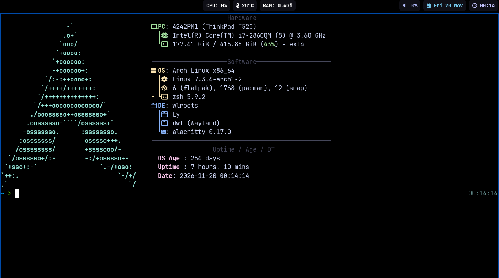
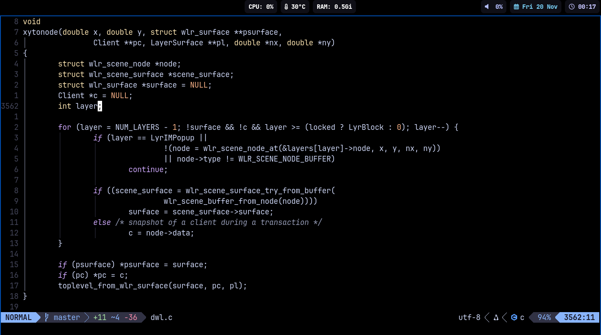
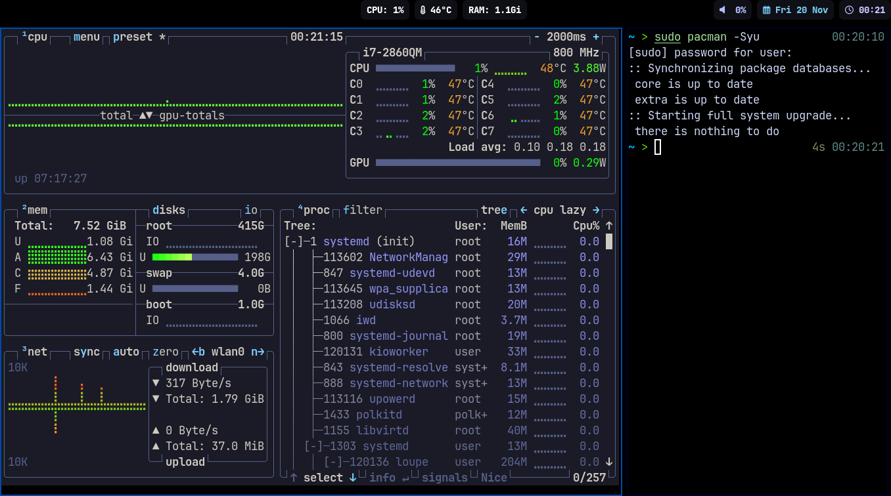
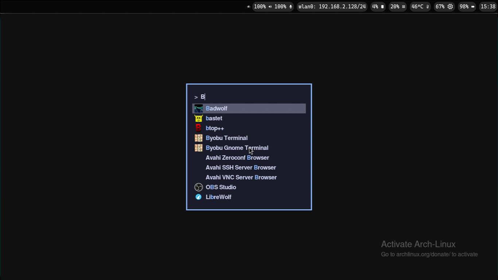

# My dotfiles
Dotfiles are files used to customize your system to your liking.  
You can modify them by editing config files using a text editor ([Neovim](https://github.com/neovim/neovim)).

**Made for Arch Linux**  

[Voir cette page en francais][fr]

If you want to **Install** your dotfiles, click [here](#Install)

Flags [documentation](docs/flags.md)

many configurations would have been impossible without these free ressources: [Credits](#Credits)

<table>
  <tr>
    <th>desktop with kitty</th>
    <th>neovim with telescope</fth>
  </tr>
  <tr>
    <td align="center">
       
    </td>
    <td align="center">
      
    </td>
  </tr>
  <tr>
    <th>neovim</th>
    <th>fuzzel</th>
  </tr>
  <tr>
    <td align="center">
      
    </td>
    <td align="center">
      
    </td>
  </tr>
</table>

## prerequisites
- an Arch based distribution of linux (Windows will **never** get support)

## programs modified 

When doing a full installation, you are installing all of the following programs:

- **neovim**
    - lazy, telescope and lualine
- **hyprland**
    - with hypridle
- sway
    - with swaylock config
- **waybar**
- btop
- bpytop 
- cava
- fastfetch
- fuzzel
- rofi
    - with colour schemes
- gtklock
    - custom lockscreen background
- kitty
    - font options
    - color scheme
- mpv
    - with shaders

--- 

## Install

>  **Warning** Be careful running scripts found on the internet!

Before executing the bash script

This is a script to help new users configure their system to tbeir liking.  
You can use this script to install your dotfiles, update your dotfiles and configure your environment! 

## Keybinds for Hyprland

Useful keybinds to know:

(super = "Windows key")
 
 super + Q -> **execute kitty**
> (the default terminal)

super + M -> **exit hyprland**

super + V -> **Toggle Floating Mode**
> ( Allows windows to stack on top of each other)

super + C -> **Close Window**

### execute programs (in Hyprland)

super + R -> **execute [Fuzzel](https://codeberg.org/dnkl/fuzzel)**
> (fuzzel is an App launcher and fuzzy finder for Wayland)
   
super + E -> **execute [Dolphin](https://github.com/KDE/dolphin)**
> (A GUI file manager)
    
super + 1 -> **execute [Floorp](https://github.com/Floorp-Projects/Floorp)** 
> (firefox/gecko based web browser) 
   
super + 2 -> **execute [Firefox](https://github.com/mozilla-firefox/firefox)** 
> (a web browser using the gecko engine)

super + 3 -> **execute [Chromium](https://source.chromium.org/chromium)** 
> (Chromium is a DeGoogled Chromium based browser)

super + 4 -> **execute [LibreWolf](https://codeberg.org/librewolf/source)**
> (firefox/gecko based web browser)

## Multi Tasking

super + F1 -> **switch to Workspace 1**

super + shift + F1 -> **move window to Workspace 1** 
 
 > *super + (F1-F11) -> Workspaces (1-11)*

If you ever encounter an issue please report it by providing the issue you are experiencing with a log, it helps me improve this script. 

## Credits 

Many configs were directly from or inspired by [@kzndotsh](https://github.com/kzndotsh)

AMD FSR: https://github.com/haasn/fsrcnn-mpv

(fuzzel, cava, waybar...)

You can find the original content at: [github.com/kzndotsh/dotfiles](https://github.com/kzndotsh/dotfiles)

other credits:

fastfetch config: [github.com/harilvfs/fastfetch](https://github.com/harilvfs/fastfetch)

linux kernel source code: [github.com/torvalds/linux](https://github.com/torvalds/linux)

nvim ascii art [github.com/Matt-FTW/dotfiles](https://github.com/Matt-FTW/dotfiles)

SwayWM source code: [github.com/swaywm/sway](https://github.com/swaywm/sway)

wlroots source code: [gitlab.freedesktop.org/wlroots/wlroots](https://gitlab.freedesktop.org/wlroots/wlroots)

Waybar source code: [github.com/Alexays/Waybar](https://github.com/Alexays/Waybar)

Catppuccin Neovim theme [github.com/catppuccin/nvim](https://github.com/catppuccin/nvim)

Catppuccin Fuzzel theme [github.com/catppuccin/fuzzel](https://github.com/catppuccin/fuzzel)

Catppuccin Hyprlock theme (not in use) [github.com/catppuccin/hyprlock](https://github.com/catppuccin/hyprlock)

Current Hyprlock theme based on [github.com/MrVivekRajan/Hyprlock-Styles/](https://github.com/MrVivekRajan/Hyprlock-Styles/blob/main/Style-2/hyprlock.conf)

[fr]: assets/README.fr.md
